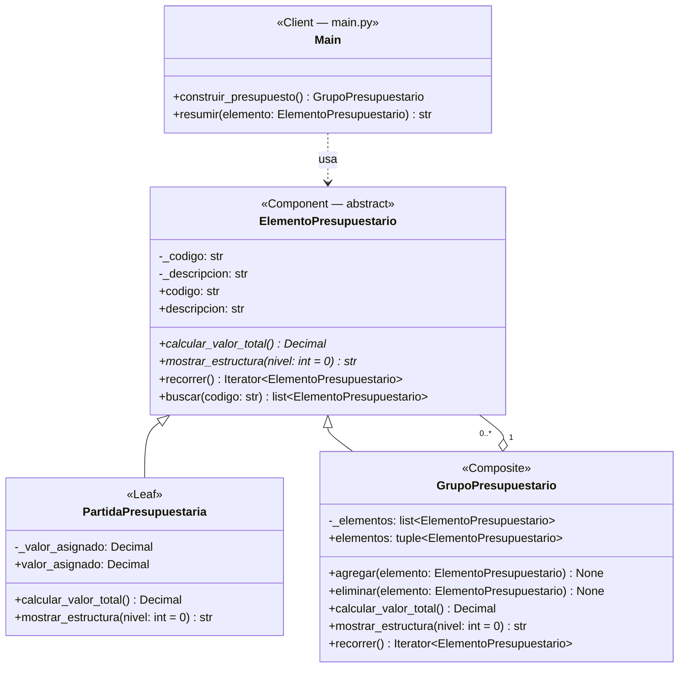
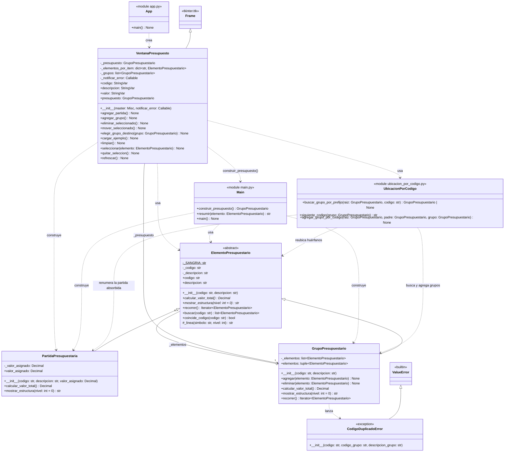
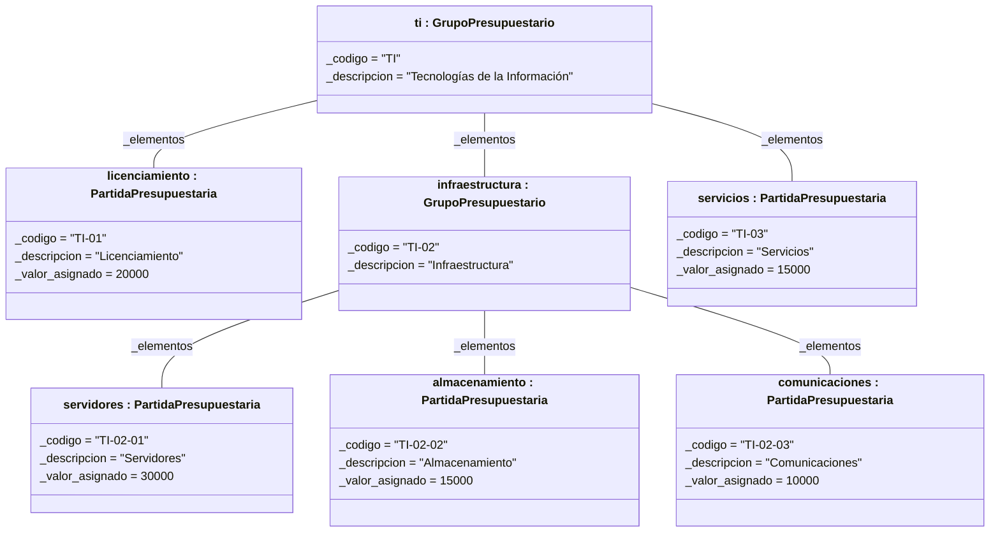

# Escenario 1 — Diagrama de clases (Composite)

## Vista del patrón Composite

Solo los participantes del patrón y sus relaciones.



## Vista completa de la solución

Incluye los Clients (`main.py` y la interfaz gráfica), las reglas de codificación y la excepción de dominio.



> Notación: `*` = método abstracto, `$` = atributo de clase, `#` = uso interno de la jerarquía. `codigo`, `descripcion`, `valor_asignado`, `elementos` y `presupuesto` son propiedades de solo lectura (`@property`). En `VentanaPresupuesto` se omiten los métodos privados de armado de widgets (`_construir_*`) y las propiedades de observación usadas por los tests (`*_mostrado`), que son detalle de presentación.

## Participantes del patrón

| Rol Composite | Clase / módulo | Archivo | Responsabilidad |
|---|---|---|---|
| **Component** | `ElementoPresupuestario` | `presupuesto/elemento_presupuestario.py` | Abstracción común (ABC): código, descripción, valor total y estructura |
| **Leaf** | `PartidaPresupuestaria` | `presupuesto/partida_presupuestaria.py` | Elemento básico; su valor total es su `valor_asignado` |
| **Composite** | `GrupoPresupuestario` | `presupuesto/grupo_presupuestario.py` | Contiene `ElementoPresupuestario` (partidas o grupos); su total es la suma recursiva de sus elementos |
| **Client** | `main` | `main.py` | Arma la jerarquía de ejemplo y la consulta solo a través de `ElementoPresupuestario` |
| **Client** | `VentanaPresupuesto` | `interfaz/ventana_presupuesto.py` | Interfaz gráfica (tkinter): el usuario arma la jerarquía a mano; totales y estructura se obtienen con `calcular_valor_total()` y `mostrar_estructura()` |

## Decisiones de diseño

- **Composite seguro**: `agregar()` y `eliminar()` viven solo en `GrupoPresupuestario`. Una partida no puede contener elementos, así que no expone operaciones sin sentido para ella.
- **Códigos únicos por grupo**: `agregar()` lanza `CodigoDuplicadoError` si el grupo ya contiene un elemento con el mismo código (sin distinguir mayúsculas ni espacios). La regla vive en el dominio, así la respetan todos los Clients; el mismo código sí puede repetirse en grupos distintos. Hereda de `ValueError`, por lo que la GUI la informa sin tratamiento especial.
- **Recorrido recursivo uniforme**: `recorrer()` es una operación del Component: la partida se devuelve a sí misma y el grupo se devuelve a sí mismo más el recorrido de cada hijo. Sobre ella se construyen `buscar(codigo)` y la protección contra ciclos de `agregar()`, que impide meter un grupo dentro de sí mismo o de uno de sus descendientes (evita recursión infinita al calcular totales o mover grupos).
- **Ubicación por código**: `buscar_grupo_por_prefijo()` toma el prefijo antes del último guion (`TI-02-04` → `TI-02`) y lo busca en todo el árbol con `buscar()`. Si existe como grupo, ese grupo tiene prioridad sobre la selección de la GUI; si no existe (o el código no tiene guion) devuelve `None` y la GUI usa el grupo seleccionado o la raíz. Si el prefijo es una partida o hay varios grupos con ese código, lanza `ValueError`. Es una regla de codificación institucional, no del patrón, por eso vive en un módulo aparte y no en las clases Composite.
- **Crear un grupo reorganiza por código**: `agregar_grupo_por_codigo()` agrega el grupo `X` y luego:
  1. **Reubica los huérfanos**: mueve dentro de `X` todo elemento del árbol (partida o grupo, con sus hijos) cuyo prefijo sea `X` y cuyo padre actual *no* sea ya un grupo `X`. Así no le quita elementos a otro grupo con el mismo código (los códigos son únicos por grupo, no globales). El árbol se recorre por niveles, de modo que ante dos huérfanos con el mismo código entra el más cercano a la raíz; el otro queda donde está.
  2. **Absorbe la partida homónima**: si en el mismo padre existía una partida con el código `X` (p. ej. la partida `PR` al crear el grupo `PR`), la mueve adentro con el siguiente código numerado libre (`siguiente_codigo()` → `PR-03` si ya estaban `PR-01` y `PR-02`), conservando descripción y valor. Como `codigo` es de solo lectura, se crea una partida nueva en lugar de modificar la existente.
- **Cambio de grupo**: la GUI mueve un elemento con `destino.agregar()` seguido de `origen.eliminar()`. Si `agregar()` falla (código duplicado o ciclo), el elemento queda intacto en su grupo original.
- **Agregación hacia la abstracción** (`o--` a `ElementoPresupuestario`): permite que un grupo contenga partidas y otros grupos, con niveles ilimitados.
- **Clase abstracta (`ABC`)**: Python no tiene interfaces; `ABC` + `@abstractmethod` impide instanciar el Component y obliga a las subclases a implementar el contrato.
- **Estado común en el Component**: `codigo`, `descripcion`, su validación y el formato de línea (`_linea`) viven en `ElementoPresupuestario`, evitando duplicarlos en Leaf y Composite. Cada subclase solo define lo que la distingue: cómo calcula su total y su símbolo (`-` partida, `+` grupo).
- **`Decimal`** para valores monetarios: evita los errores de redondeo de `float`.
- **`elementos` devuelve una `tuple`**: el cliente puede recorrer los hijos, pero solo modificarlos mediante `agregar()`/`eliminar()`.
- **`mostrar_estructura(nivel)` devuelve `str`**: el nivel controla la sangría y devolver texto (en vez de imprimir) hace la operación testeable. La GUI reutiliza esa misma salida sin cambiar el dominio.
- **Capas separadas**: `presupuesto/` (dominio) no conoce a `interfaz/` (presentación); la dependencia va en un solo sentido. Agregar la GUI no modificó ninguna clase del patrón.
- **Raíz institucional en la GUI**: `VentanaPresupuesto` siempre trabaja sobre `GrupoPresupuestario("PRES", "Presupuesto institucional")`; el ejemplo de TI se agrega como un grupo más dentro de ella, para poder crear otros grupos al mismo nivel (p. ej. Talento Humano).
- **El Client que construye conoce al Composite**: con Composite seguro, la GUI necesita saber si el nodo seleccionado es un `GrupoPresupuestario` para poder agregarle hijos. Las consultas (total, estructura), en cambio, son uniformes.

## Diagrama de objetos (ejemplo del enunciado)

Instancias que crea `construir_presupuesto()` en `main.py`. Cada objeto muestra `nombre : Clase` y sus slots `atributo = valor`; los enlaces son instancias de la agregación `_elementos`.



> Mermaid no permite subrayar el nombre del objeto como indica UML; se usa el formato `nombre : Clase` en el encabezado.
>
> Los grupos **no tienen** un slot `total`: el total no es un atributo almacenado sino el resultado de `calcular_valor_total()` (`ti` → 90 000, `infraestructura` → 55 000).

## Cómo ejecutar

```bash
cd Escenario_1_Composite
python3 app.py                                   # interfaz gráfica
python3 main.py                                  # demo por consola
python3 -m unittest discover -s tests -t .       # 26 tests
```

> Requiere tkinter. En macOS con Python de Homebrew: `brew install python-tk@3.14`. En Windows/Linux con el instalador oficial de python.org ya viene incluido.
