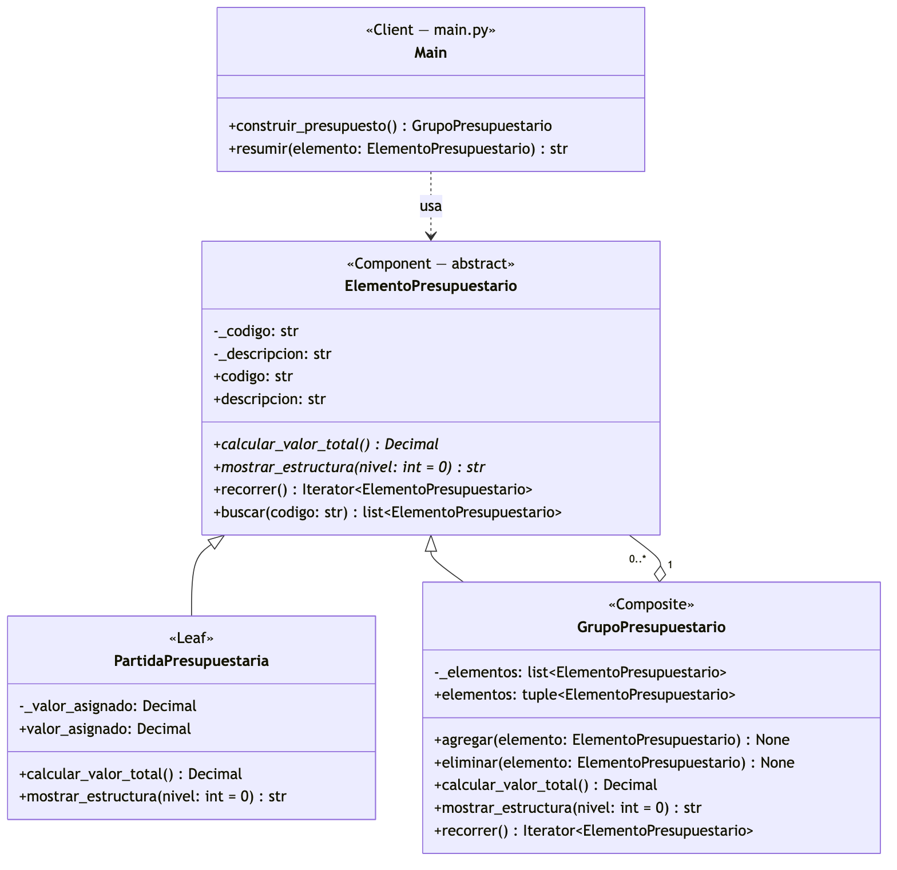
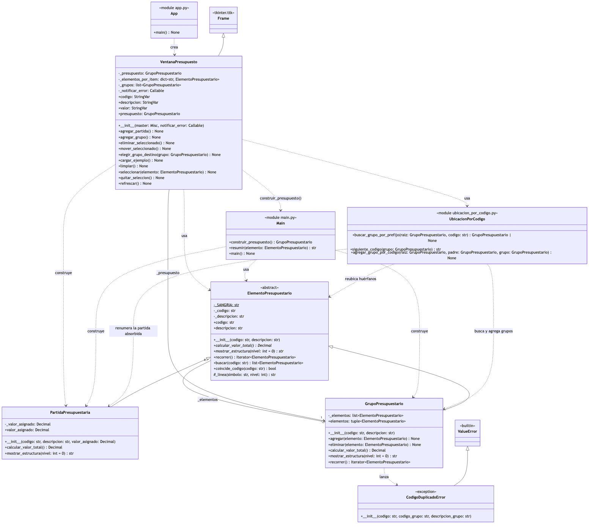
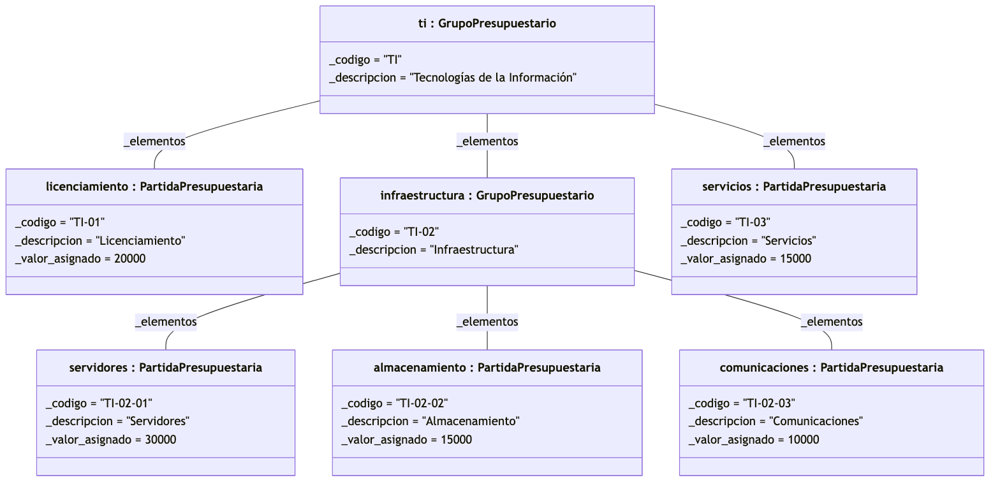

# Escenario 01 — Presupuesto jerárquico (patrón Composite)

## Justificación

### Problema estructural identificado

La institución debe representar su presupuesto como una **jerarquía parte‑todo** de profundidad variable:

- Las **partidas presupuestarias** son los elementos básicos (código, descripción y valor asignado).
- Los **grupos presupuestarios** contienen partidas y también otros grupos, formando varios niveles (por ejemplo, *Tecnologías de la Información → Infraestructura → Servidores*).

Ambos tipos deben responder a las mismas operaciones: obtener código y descripción, calcular su valor total y mostrar su estructura. Sin un diseño adecuado, el código cliente tendría que preguntar en cada paso **"¿esto es una partida o un grupo?"** para decidir cómo calcular el valor o cómo recorrer sus componentes. Esa distinción:

- se repite en cada operación (condicionales `if`/`isinstance` dispersos);
- obliga a modificar el cliente cada vez que aparece un nuevo nivel de agrupación, violando el principio Abierto/Cerrado;
- no escala a jerarquías de profundidad arbitraria sin escribir recorridos recursivos en el propio cliente.

### Patrón seleccionado: Composite

El patrón **Composite** (GoF, estructural) tiene como intención *componer objetos en estructuras de árbol para representar jerarquías parte‑todo y permitir que los clientes traten de manera uniforme a los objetos individuales y a sus composiciones*. Coincide punto por punto con lo que pide el escenario:

| Requisito del escenario | Cómo lo resuelve Composite |
|---|---|
| Partidas y grupos tratados con **una misma abstracción** | Ambos heredan de `ElementoPresupuestario` (Component); el cliente solo conoce esa abstracción. |
| Un grupo contiene **partidas y otros grupos** | `GrupoPresupuestario` agrega una lista de `ElementoPresupuestario`, no de partidas: puede contener cualquier elemento. |
| Valor total de una partida = **valor asignado** | `PartidaPresupuestaria.calcular_valor_total()` devuelve `valor_asignado`. |
| Valor total de un grupo = **suma recursiva** de sus elementos | `GrupoPresupuestario.calcular_valor_total()` delega en cada hijo y suma; la recursión vive en el Composite, no en el cliente. |
| **Mostrar la estructura** | `mostrar_estructura(nivel)` se implementa en hoja y compuesto; el grupo se muestra a sí mismo y delega en sus hijos con un nivel más de sangría. |
| **Crecer sin modificar** la lógica principal | Agregar niveles es solo agregar grupos dentro de grupos. Prueba de ello: se incorporó una interfaz gráfica completa como nuevo cliente **sin modificar ninguna clase del patrón**. |

### Alternativas consideradas y descartadas

- **Condicionales en el cliente (`isinstance`)**: es precisamente el problema que el escenario pide evitar.
- **Decorator**: también usa composición recursiva, pero su intención es *agregar responsabilidades* a un objeto, no representar una jerarquía parte‑todo con muchos hijos.
- **Visitor**: resuelve el agregar *operaciones nuevas* sin tocar las clases, no la *estructura*. Se descartó para no sobredimensionar la solución; queda como extensión natural si en el futuro se requieren nuevos reportes sobre el presupuesto.

### Participantes del patrón en la solución

| Rol Composite | Clase / módulo | Archivo | Responsabilidad |
|---|---|---|---|
| **Component** | `ElementoPresupuestario` (clase abstracta) | `presupuesto/elemento_presupuestario.py` | Define la interfaz común: `codigo`, `descripcion`, `calcular_valor_total()`, `mostrar_estructura()`, `recorrer()` y `buscar()`. |
| **Leaf** | `PartidaPresupuestaria` | `presupuesto/partida_presupuestaria.py` | Elemento básico; su total es su `valor_asignado`. No puede contener elementos. |
| **Composite** | `GrupoPresupuestario` | `presupuesto/grupo_presupuestario.py` | Contiene `ElementoPresupuestario` (partidas o grupos), ofrece `agregar()`/`eliminar()` y calcula su total sumando recursivamente a sus hijos. |
| **Client** | `main` | `main.py` | Arma el presupuesto de ejemplo y lo consulta solo a través de `ElementoPresupuestario`. |
| **Client** | `VentanaPresupuesto` | `interfaz/ventana_presupuesto.py` | Interfaz gráfica (tkinter) para construir el presupuesto manualmente; totales y estructura se obtienen con las operaciones del Component. |

### Decisiones de diseño

1. **Composite "seguro" en lugar de "transparente"**: `agregar()` y `eliminar()` existen solo en `GrupoPresupuestario`. Una partida no puede contener elementos, por lo que no expone operaciones que carecen de sentido para ella (en la variante transparente lanzarían excepciones en tiempo de ejecución). El costo es que quien **construye** el árbol debe conocer al Composite; las **consultas** (total, estructura, búsqueda) siguen siendo uniformes, que es lo que exige el escenario.
2. **Agregación hacia la abstracción** (`GrupoPresupuestario o-- 0..* ElementoPresupuestario`): es la relación que define al patrón y permite niveles ilimitados.
3. **Component como clase abstracta con estado**: Python no tiene interfaces; se usa `ABC` + `@abstractmethod`. El código, la descripción y su validación viven en el Component para no duplicarlos en Leaf y Composite.
4. **`Decimal` para valores monetarios**: evita los errores de redondeo de `float`.
5. **Recorrido recursivo uniforme (`recorrer()`)**: la partida se devuelve a sí misma; el grupo, a sí mismo más el recorrido de cada hijo. Sobre esta operación se construyen `buscar(codigo)` y la protección contra ciclos: `agregar()` impide que un grupo se contenga a sí mismo o a uno de sus ancestros, lo que provocaría recursión infinita al calcular totales.
6. **Códigos únicos por grupo**: `agregar()` lanza `CodigoDuplicadoError` (subclase de `ValueError`) si el grupo ya contiene ese código. La regla está en el dominio para que la respeten todos los clientes.
7. **Reglas de codificación fuera del patrón**: la ubicación automática por prefijo (`TI-05` → grupo `TI`), la reubicación de elementos huérfanos al crear un grupo y la numeración `PR-01`, `PR-02` viven en `presupuesto/ubicacion_por_codigo.py`. Son convenciones de la institución, no parte de Composite, y así pueden cambiar sin tocar las clases del patrón.
8. **Separación en capas**: `presupuesto/` (dominio) no conoce a `interfaz/` (presentación); la dependencia va en un solo sentido.

## Diagrama de clases

**Figura 1. Participantes del patrón Composite.**



**Figura 2. Vista completa de la solución** (incluye clientes, reglas de codificación y excepción de dominio).



**Figura 3. Diagrama de objetos del ejemplo del enunciado** (instancias creadas por `construir_presupuesto()`). Los grupos no tienen un atributo `total`: el total no se almacena, se calcula con `calcular_valor_total()` (TI = 90 000; Infraestructura = 55 000).



### Correspondencia UML – código

| Elemento UML | Implementación |
|---|---|
| Clase abstracta `ElementoPresupuestario` | `class ElementoPresupuestario(ABC)` en `presupuesto/elemento_presupuestario.py` |
| Generalización Leaf / Composite | `class PartidaPresupuestaria(ElementoPresupuestario)` y `class GrupoPresupuestario(ElementoPresupuestario)` |
| Agregación `_elementos 0..*` | `self._elementos: list[ElementoPresupuestario]` en `GrupoPresupuestario` |
| Operaciones abstractas (*cursiva*) | `@abstractmethod calcular_valor_total()` y `mostrar_estructura()` |
| Objetos del diagrama de objetos | Variables `ti`, `licenciamiento`, `infraestructura`, `servidores`, `almacenamiento`, `comunicaciones`, `servicios` en `main.construir_presupuesto()` |

La correspondencia se verificó con un script que comprueba que cada atributo y método del diagrama existe en el código, y que los nombres y valores del diagrama de objetos coinciden con las instancias reales.

## Código fuente

- **Repositorio:** https://github.com/NightMare2210/PDS_Actividad_02 — carpeta `Escenario_1_Composite/`
- **Lenguaje:** Python 3 (solo biblioteca estándar; la interfaz usa tkinter).

```text
Escenario_1_Composite/
├── presupuesto/                      # Dominio
│   ├── elemento_presupuestario.py    # Component
│   ├── partida_presupuestaria.py     # Leaf
│   ├── grupo_presupuestario.py       # Composite
│   ├── codigo_duplicado_error.py     # Excepción de dominio
│   └── ubicacion_por_codigo.py       # Reglas de codificación
├── interfaz/ventana_presupuesto.py   # Client gráfico
├── main.py                           # Client por consola
├── app.py                            # Lanzador de la interfaz gráfica
├── tests/                            # 73 pruebas unitarias
└── diagrama.md                       # Diagramas UML (Mermaid)
```

**Ejecución:**

```bash
cd Escenario_1_Composite
python3 app.py                               # interfaz gráfica
python3 main.py                              # demostración por consola
python3 -m unittest discover -s tests -t .   # pruebas
```

**Salida de `main.py`:**

```text
=== Estructura del presupuesto ===
+ [TI] Tecnologías de la Información: 90,000.00
  - [TI-01] Licenciamiento: 20,000.00
  + [TI-02] Infraestructura: 55,000.00
    - [TI-02-01] Servidores: 30,000.00
    - [TI-02-02] Almacenamiento: 15,000.00
    - [TI-02-03] Comunicaciones: 10,000.00
  - [TI-03] Servicios: 15,000.00
```

## Uso crítico de inteligencia artificial

Herramienta utilizada: Claude Code (asistente de programación). La IA se usó como apoyo para diseñar, implementar y probar; las decisiones finales y la validación del comportamiento quedaron a cargo del grupo.

### Prompt principal

> "Sí, arranquemos con el diagrama de clases en Java con el Composite."

Contexto: el prompt se formuló después de pedir a la IA el análisis del Escenario 01 y la identificación del problema estructural. A partir de ahí la solución se refinó con prompts sucesivos, entre ellos:

- "El código hagámoslo en Python."
- "El código debe estar relacionado con los elementos y atributos que hemos señalado en el diagrama UML."
- "Hagamos una interfaz gráfica en la que podamos construir los presupuestos de forma manual y no introduciéndolos directo desde el código."
- "Agrega una excepción que no permita que el código de una partida o grupo se repita en el mismo grupo."

### Recomendación aceptada (con justificación)

**Recomendación:** implementar la variante **"segura"** de Composite: declarar `agregar()` y `eliminar()` solo en `GrupoPresupuestario` y no en la abstracción común `ElementoPresupuestario`.

**Justificación de la aceptación:** en la variante "transparente", `PartidaPresupuestaria` heredaría un método `agregar()` que no tiene sentido para ella y que solo podría lanzar una excepción en tiempo de ejecución. Con la variante segura, el modelo refleja el dominio (una partida no contiene elementos) y el error se evita por diseño. Se verificó que el costo de esta decisión es aceptable: solo quien **construye** el árbol necesita conocer `GrupoPresupuestario`, mientras que las **consultas** que exige el escenario (código, descripción, valor total y estructura) siguen siendo totalmente uniformes a través de `ElementoPresupuestario`.

### Recomendación modificada o rechazada (con justificación)

**Recomendación de la IA:** al agregar un elemento en la interfaz gráfica, **la selección del árbol debía tener prioridad** sobre el prefijo del código; la ubicación por prefijo (`PR-01` → grupo `PR`) solo se aplicaba si no había nada seleccionado.

**Decisión: rechazada y reemplazada.** Al probar la aplicación, el grupo detectó un comportamiento incorrecto: después de crear el grupo `PR` la interfaz dejaba seleccionada la raíz, y la partida `PR-01` terminaba fuera de `PR`. Se reprodujo el caso y se invirtió la regla: **si el prefijo del código existe como grupo, ese grupo tiene prioridad**; la selección solo se usa cuando el prefijo no existe. Además se agregó que, al crear un grupo, se reubiquen automáticamente los elementos existentes con su prefijo y que una partida con el mismo código que el grupo pase a ser su primera subpartida numerada (`PR` → `PR-01`).

**Justificación:** la recomendación original era técnicamente coherente, pero producía un resultado contrario a la convención de codificación de la institución, que es la que el usuario espera. La IA no tenía forma de conocer esa expectativa: el error solo se descubrió **probando la aplicación con casos reales**, lo que confirma que las propuestas de la IA deben validarse y no aceptarse de forma automática.

### Otras correcciones al trabajo de la IA

- **Diagrama de objetos:** la primera versión generada era un diagrama de flujo que mostraba un "total" dentro de cada grupo. Al revisarlo se exigió notación UML de objetos (`nombre : Clase` con *slots* `atributo = valor`) y se eliminó el `total`, porque no es un atributo almacenado sino el resultado de `calcular_valor_total()`; mostrarlo contradecía el diagrama de clases y el código.
- **Lenguaje de implementación:** el diagrama de clases se generó primero con tipos de Java (`BigDecimal`, `List`, `getCodigo()`). Al decidir implementar en Python, se exigió rehacerlo con tipos y convenciones de Python (`Decimal`, `ABC`, propiedades) en lugar de mantener un diagrama en un lenguaje y el código en otro, ya que eso rompía la correspondencia UML–código.
